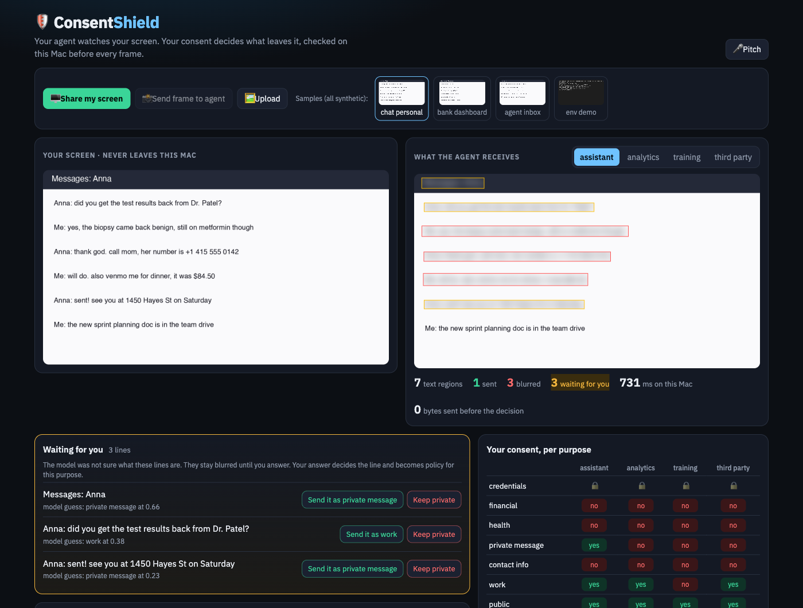

# 🛡️ ConsentShield

**Your agent watches your screen. Your consent decides what leaves it.**



Personal agents now see the screen: computer-use agents, "remember everything" assistants, Claude
through MCP. Every screenshot they send to the cloud carries whatever was open: a chat about a
biopsy, a bank balance, an `.env` file. Consent today is a cookie banner on a website. Nothing asks
at the moment an agent actually takes your data.

ConsentShield sits between the screen and the agent, on the device:

```
screen frame ─► OCR on device (Apple Vision)
             ─► detectors first: secrets, card numbers, money, prompt injection   (deterministic)
             ─► local decision model (Laya, open Jev): data category + calibrated confidence
             ─► your consent per (category × purpose): assistant · analytics · training · third party
             ─► confident (≥ 0.8) → act alone: send or blur · unsure → hold it blurred and ask you
             ─► the cloud agent gets the redacted frame · a consent ledger records every decision
```

Nothing leaves the Mac before the decision. The ledger stores categories and outcomes, never the text.

Built at the **super{set} national renaissance hackathon**, San Francisco, 22 Oct 2026,
track *Personal agents and data privacy*.

## Why this shape

- **Consent at the moment of action.** Purposes (assistant / analytics / training / third party) are
  the model privacy platforms like Ketch use for websites; here they are enforced per frame, per agent.
- **Detectors before models.** A key or a card number is blurred by a regex no model can talk out of it.
  Credentials are locked: no consent toggle can release them.
- **Calibrated, local decisions.** [Laya](https://huggingface.co/convaiinnovations/laya) (Apache 2.0
  reproduction of TypeSafe's Jev) answers a typed question with a probability in ~30 ms on Apple
  silicon. Act alone at ≥ 0.8, otherwise ask, the rule from Vivek Haldar's
  [decision models in agent harnesses](https://vivekhaldar.com/articles/llms-do-too-much-offload-to-decision-models/).
- **Fail closed.** An "ask" stays blurred until you answer. Your answer decides that line and becomes
  policy for the purpose; the ledger records it as a human decision.

## Run (macOS, Apple silicon)

```bash
brew tap fortunto2/tap && brew install screenshield   # ships the visionscan OCR helper
uv sync
make run        # http://localhost:8790 , Share screen or click a sample
make demo       # same gate from the CLI over fixtures/
```

Samples in `fixtures/` are synthetic: every name, number and diagnosis is invented.

## Plug it into a real agent (MCP)

The same gate is an MCP server. The agent calls `screenshot(purpose)` and receives the redacted frame
plus a list of what was held back and why; the raw pixels never enter its context. Answers you give in
the web UI apply to the agent's next frame, and both write the same consent ledger.

```bash
claude mcp add consentshield -- uv run --directory "$PWD" python -m app.mcp_server   # Claude Code
make mcp                                                                             # or any MCP client over stdio
```

This repo ships `.mcp.json`, so Claude Code started inside it already has the tool. Claude Desktop takes
the same command in `claude_desktop_config.json`. Tools: `screenshot(purpose, path=None)` and `consent_policy()`.

## Measured on the samples (M-series Mac, purpose = assistant)

| Screen | regions | sent | blurred | asked | time |
|---|---|---|---|---|---|
| personal chat | 7 | 2 | 2 | 3 | 1.4 s (first frame, warm-up) |
| bank dashboard | 7 | 1 | 5 | 1 | 0.16 s |
| work inbox with injection | 6 | 2 | 2 | 2 | 0.32 s |

Honest limits: Laya is small and often unsure on short chat lines, which is exactly why those go to
the human instead of silently through. OCR boxes are per line, not per word.

## Team

Rustam Salavatov ([fortunto2](https://github.com/fortunto2)). Reuses the OCR and detectors of
[ScreenShield](https://github.com/fortunto2/screenshield) (3rd place, Cyberdefense Hackathon, SF, 9 Oct 2026).

MIT.
